<div align="center">





```console
pape@github ~ $ cat about.txt
```

**Pape Cheikh Keinde** · Développeur full-stack · Dakar, Sénégal

Je construis des applications de gestion : Next.js, React, Laravel, Flutter.

```console
pape@github ~ $ ./links.sh
```

[](https://github.com/Pkeinde6)

</div>
